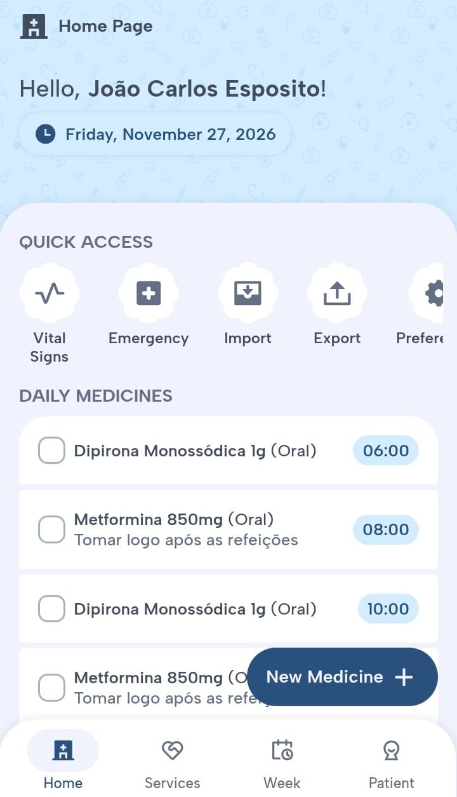
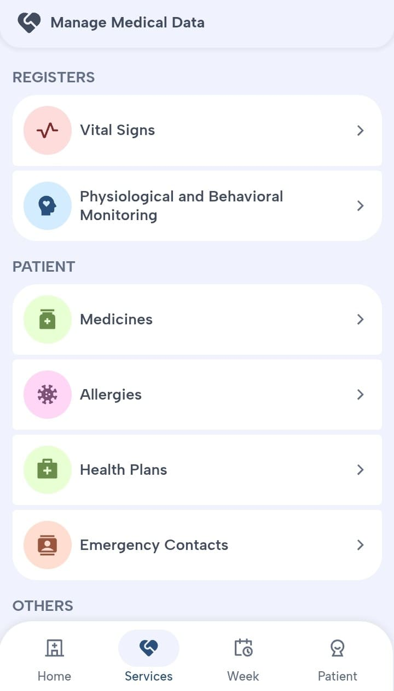
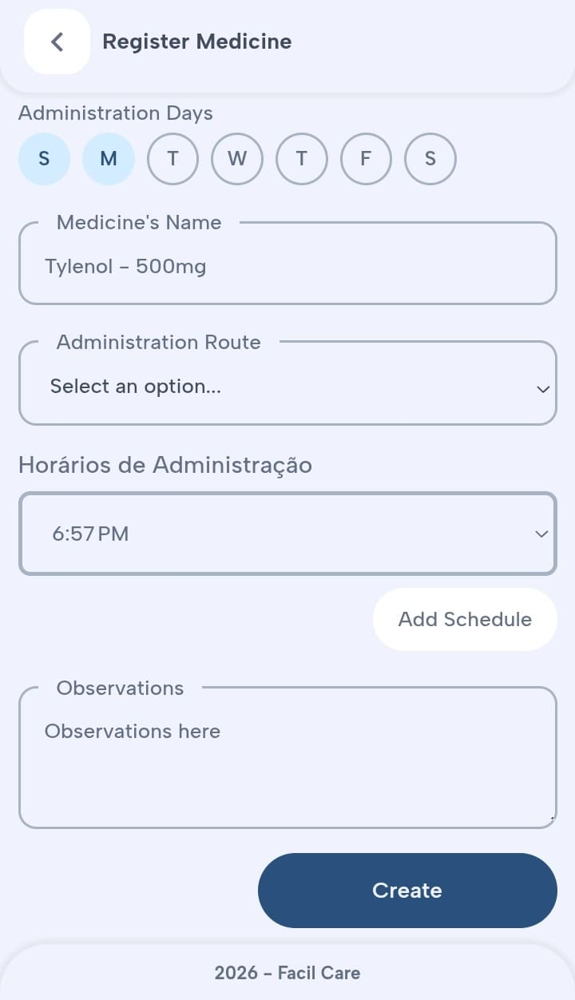
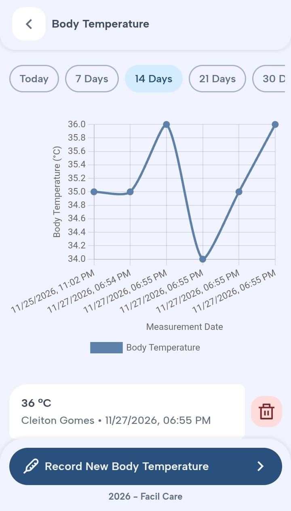
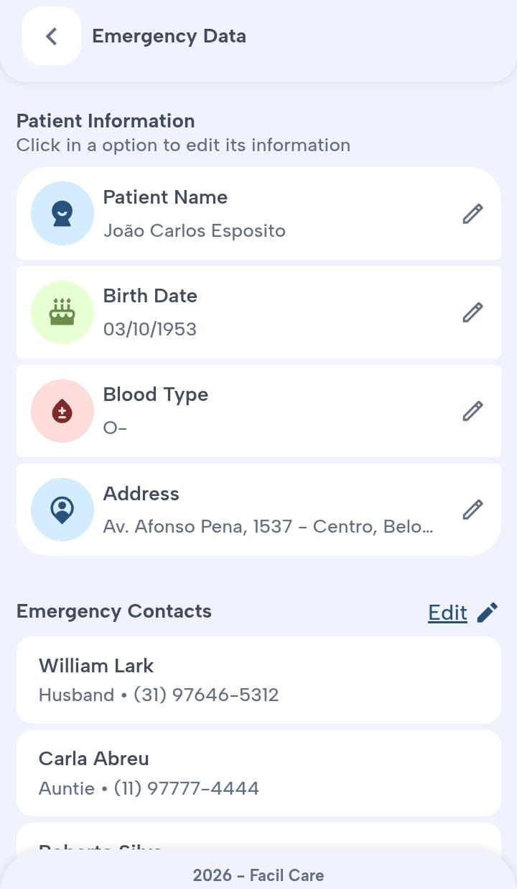

<div align="center">
  
  <h1>FacilCare</h1>
  <p><strong>Health Monitoring</strong> PWA Offline-First</p>
</div>
 
<div align="center">
  <a href="https://www.figma.com/design/Hz5x5uWg9bis53saHyB4vJ/Cuidados-Di%C3%A1rios?node-id=0-1&p=f&t=72omA2iRuWiTJfML-0" rel="external" target="_blank">
    
  </a>

  <a href="https://facilcare.vercel.app" rel="external" target="_blank">
    
  </a>
</div>

> [!note]
> With the **accelerated aging** of the population in Brazil and worldwide, families need to **monitor** the health routines of the elderly in **real time**.

A **Offline-First Progressive Web App** _(PWA)_ designed to **streamline the daily tasks of caregivers**, enabling the management of a patient's medical data while 
ensuring **privacy** directly on the **user's device** eliminating.
**Data** can be **backed up** via a **JSON** file or through **P2P** synchronization (WebRTC) by scanning a QR code.

System Pictures
---
<table>
  <tr style="display: grid; grid-template-columns: repeat(5, 1fr)">
    <td>
      
    </td>
    <td>
      
    </td>
    <td>
      
    </td>
    <td>
      
    </td>
    <td>
      
    </td>
  </tr>
</table>

---

## Features
### Management of Profile and Emergency Data `**`
- **Basic Medical Record:**
    - Personal Data *(name, address, and birthdate)*
    - Blood type
    - Allergies
    - Health ensure plans
- **Others:**
    - Close family members
    - Doctors
    - Patient caregivers

### Care Routine
- Allows for viewing each record individually, presenting:
  - Statistics _(sorted / filtered by date)_
  - Most recent record / measurements
- **Vital Signs Registries**:
    - Blood glucose, blood pressure, body temperature, oxygen saturation, heart rate etc.
- **Physiological and Behavioral Monitoring**:
    - Mood, pain level, sleep quality, meal acceptance, water ingestion, weigth etc.

### Medicines Management `***`
- **Scheduling Registration**:
    - Medicines registries _(dosages, administration route,daily times, and observations)_
- **Scheduling Checklist**
    - View the medications the patient needs to take for the day _(or the week)_
    - Marking as administered or not

### Data Analytics _(Resume)_
- **Interactive Dashboard**:
    - Graphs representing, for example, a patient's vital signs (selectable time period)
      - Highest value
      - Lowest value
      - Average
      - others

### Data Exchange
- **JSON Backup**: Manual export and import of the **backup file** for device migration and loss prevention, without using the cloud
- **P2P Sync (WebRTC/PeerJS)**: Direct data transfer between devices via the generation of a **QR code containing a pairing link** (`site/import?peerId=<hostPeerId>`)

### Accessibility
- **Adapted Interface**: Light, dark, and high-contrast modes

---

## Directory Scheme
```
  |
  |- public            # PWA images
  |- src              
     |- assets         # Global styles, icons, and system images
     |- components     # UI Vue components
     |- composables    # Business Rules
     |- constants
     |- controllers    # API Controllers
     |- database       # Dexie.js / IndexedDB init
     |- interfaces
     |- locales        # Languagee translate logic (i18n)
     |- models         # Models for data access
     |- router         # Navigation routes (Vue Router)
     |- types
     |- views          # System Pages
```

---

## Recursos Futuros
1. **Visual Monitoring of Lesions**: Use of the device's camera to create a photographic record of physical changes or bodily conditions
2. **Automated Inventory Management**: Automatic deduction of available medication stock upon confirmation of a dose, with visual alerts for replenishment
3. **Voice Synthesis (Web Speech API)**: Reading reminders and medication schedules aloud to assist individuals with visual impairments
4. **PDF Reports**: Local generation of formatted medical reports, including charts, using the `jsPDF` library
5. **Verify the validity of the backup file**
6. **Adapt the blood pressure form**

---
- `*` Generating a patient backup QR code requires an **internet connection**, due to the character limit constraints of the code format.
- `**` Personal data is stored exclusively within the application; no developer should have intentional access to this information.
- `***` The system serves as a tool to support daily routines; the accuracy of the scheduled times and dosage information entered is the sole responsibility of the user or caregiver.
