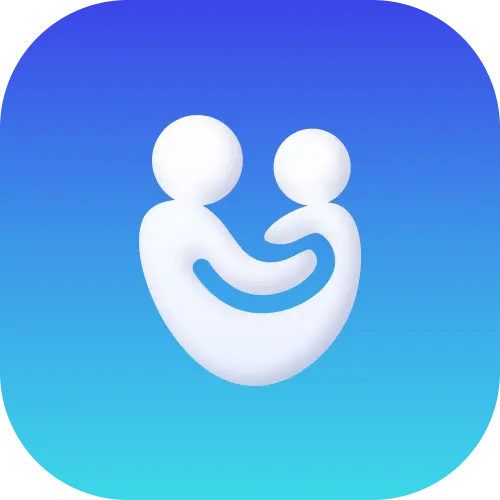
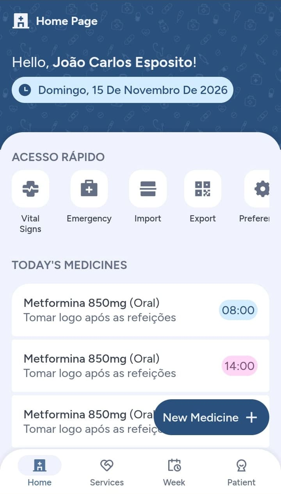
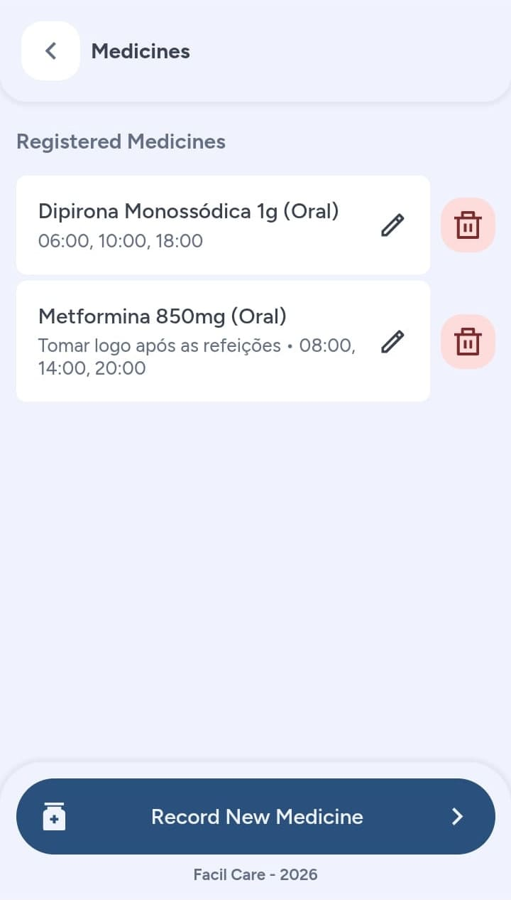
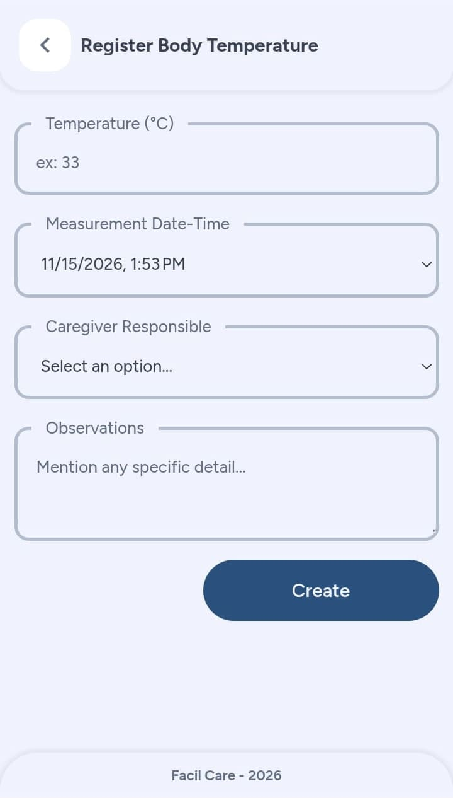
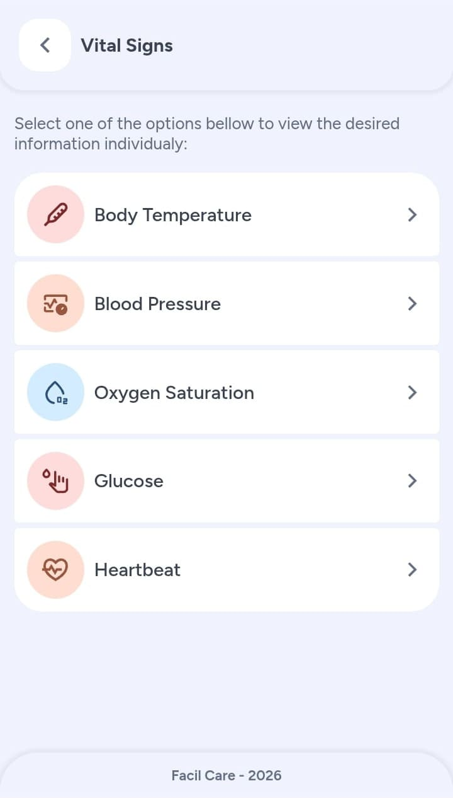

<div align="center">
  
  <h1>FacilCare</h1>
  <p>PWA <em>Offline-First</em> para <strong>Monitoramento de Saúde</strong></p>
</div>
 
<div align="center">
  <a href="https://www.figma.com/design/Hz5x5uWg9bis53saHyB4vJ/Cuidados-Di%C3%A1rios?node-id=0-1&p=f&t=72omA2iRuWiTJfML-0" rel="external" target="_blank">
    
  </a>

  <a href="https://facilcare.vercel.app" rel="external" target="_blank">
    
  </a>
</div>

> Com o **envelhecimento acelerado** da população no Brasil e no mundo, famílias precisam **monitorar** a rotina de saúde dos idosos em **tempo real**.

O *Progressive Web App* (PWA) será **100% offline** (salvo as exceções`*`), ou seja, é possível:
- Acessá-lo mesmo **sem conexão** com internet
- Manter os **dados** de um paciente com **privacidade total** (são armazenados apenas localmente)
- **Sem custos** para armazenamento na **nuvem**

Para isso, utiliza-se o banco de dados interno aos navegadores (`IndexedDB` + wrapper `Dexie.js`)

Imagens do Sistema
---
<table>
  <tr style="display: grid; grid-template-columns: repeat(5, 1fr)">
    <td>
      
    </td>
    <td>
      
    </td>
    <td>
      
    </td>
    <td>
      
    </td>
    <td>
      
    </td>
  </tr>
</table>

---

## Funcionalidades
Sistema com foco em **facilitar a rotina de cuidadores**, permitindo: 

### Gestão de Perfil e Emergência `**`
- **Ficha Médica Básica:**
    - Dados pessoais *(nome, endereço, data de nascimento)*
    - Tipo sanguíneo
    - Alergias
    - Planos de Saúde
- **Outros:**
    - Familiares Próximos
    - Médicos *(conhecidos pelo paciente ou que acompanham ele)*
    - Cuidadores do paciente

### Diário de Cuidados e Rotina Diária
- Possibilita visualizar cada registro de forma unitária, apresentando:
  - Estatísticas (filtradas por data)
  - Últimas medições/registros
- **Registro de sinais vitais**:
    - glicemia, pressão arterial, temperatura, saturação de oxigênio, frequência cardíaca etc.
- **Acompanhamento Fisiológico e Comportamental**:
    - Humor, nível de dor, qualidade do sono, aceitação de refeições, ingestão de àgua, peso e controle de evacuação e diurese

### Controle de Medicamentos `***`
- **Cadastro de Aprazamento**:
    - Registro de medicamentos *(dosagens, via de administração, horários e observações)*
- **Checklist de Aprazamentos**
    - Visualizar os medicamentos que o paciente precisa tomar no dia (ou na semana)
    - Marcando como administrado ou não administrado

### Análise de Dados (Relatórios)
- **Dashboard Interativo**:
    - Gráficos representando, por exemplo, sinais vitais do paciente (período selecionável)
      - Maior valor
      - Menor valor
      - Média
      - etc.

### Troca de Dados
- **Backup JSON**: Exportação e importação manual do **arquivo de backup** para migração de dispositivos e prevenção de perdas sem uso de nuvem
- **Sincronização P2P (WebRTC/PeerJS)**: Envio de dados diretamente entre dispositivos por meio da geração de **QR Code com link de pareamento** (`site/import?peerId=<hostPeerId>`)

### Acessibilidade
- **Interface Adaptada**: Modo claro, escuro e alto contraste

---

## Esquema de Pastas
```
  |
  |- public            # Imagens do PWA
  |- src              
     |- assets         # Estilos globais, fontes e ícones
     |- components     # Componentes de UI em Vue
     |- composables    # Regras de Negócio
     |- constants
     |- controllers    # Controladores da aplicação
     |- database       # Inicialização do Dexie.js / IndexedDB
     |- interfaces
     |- locales        # Lógica de tradução (idioma) (i18n)
     |- models         # Modelos de acesso aos dados
     |- router         # Rotas de navegação do Vue Router
     |- types
     |- views          # Páginas do sistema
```

---

## Future Features
1. **Visual Monitoring of Lesions**: Use of the device's camera to create a photographic record of physical changes or bodily conditions
2. **Automated Inventory Management**: Automatic deduction of available medication stock upon confirmation of a dose, with visual alerts for replenishment
3. **Voice Synthesis (Web Speech API)**: Reading reminders and medication schedules aloud to assist individuals with visual impairments
4. **PDF Reports**: Local generation of formatted medical reports, including charts, using the `jsPDF` library
5. **Verify the validity of the backup file**
6. **Adapt the blood pressure form**
>>>>>>> Stashed changes

---
- `*` Para gerar o QR Code de Backup do paciente será necessário **conexão com a internet**`*`, tendo em vista a limitação de caracteres que o código pode apresentar
- `**` Dados pessoais ficam armazenados apensa dentro do aplicativo, nenhum desenvolvedor deve ter acesso a eles de forma deliberada.
- `***` O sistema atua como uma ferramenta de apoio à rotina; a exatidão das informações de aprazamento e dosagem cadastradas é de responsabilidade exclusiva do usuário ou cuidador.

